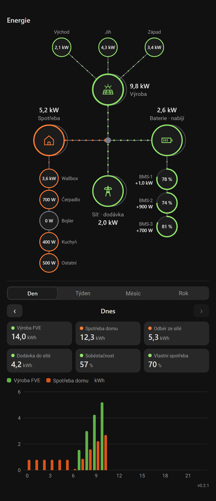
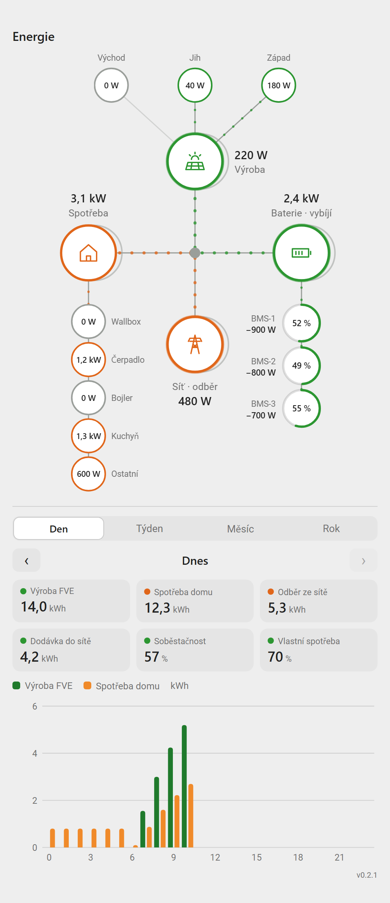

# UltimatePower Card

[English](README.md) · **Česky**

Karta pro Home Assistant, která ukazuje, kudy právě teče energie: výroba z fotovoltaiky, spotřeba domu, baterie a síť. Toky jsou animované a pod schématem je bilance energie, ve které se dá listovat do minulosti. Rozložení vychází z monitoru energie známého z Loxone.

<p>
  
  
</p>

Na obrázcích jsou ukázková data.

> **Stav:** raný vývoj (v0.x). Volby se před první stabilní verzí mohou změnit.

## Co karta umí

- **Čtyři hlavní uzly kolem středu:** výroba, spotřeba, baterie a síť. Karta se vejde do jednoho sloupce nástěnky.
- **Libovolný počet stringů, baterií a spotřebičů.** Stringy jsou v řadě nad výrobou, baterie (s kroužkem stavu nabití) a spotřebiče visí pod svým uzlem.
- **Barvy s jedním významem:** zelená je vlastní energie (výroba, baterie, dodávka do sítě), oranžová je spotřeba a odběr ze sítě. Uzel v klidu zešedne.
- **Animace toku:** tečky běží od zdroje ke spotřebiči a s výkonem výrazně zrychlují. Uzel, který energii dodává, pulzuje ven; uzel, který ji odebírá, pulzuje dovnitř.
- **Bez senzoru spotřeby domu:** spotřeba se počítá z fotovoltaiky, sítě a baterie. Co nepokryjí zadané spotřebiče, ukáže se jako „Ostatní".
- **Bilance energie:** výroba, spotřeba, odběr a dodávka do sítě, soběstačnost a vlastní spotřeba za den, týden, měsíc nebo rok. Listuje se šipkami nebo tažením po grafu. Sekci lze vypnout.
- **Baterie oběma způsoby:** jeden senzor výkonu se znaménkem, nebo zvlášť senzor nabíjení a vybíjení.
- Klik na uzel otevře jeho detail v Home Assistantu. České a anglické popisky, světlý i tmavý motiv.

Zatím chybí: vizuální editor nastavení, vlastní barvy a ikony.

## Instalace

### HACS

1. HACS → **⋮** → **Vlastní repozitáře**.
2. Přidej `Developer089/UltimatePower-Card`, typ **Dashboard** (ve starším HACS *Lovelace*).
3. Najdi **UltimatePower Card**, stáhni ji a obnov stránku v prohlížeči.

### Ručně

1. Stáhni `ultimate-power-card.js` z [posledního vydání](https://github.com/Developer089/UltimatePower-Card/releases).
2. Zkopíruj ho do `/config/www/ultimate-power-card/`.
3. Přidej zdroj nástěnky: `/local/ultimate-power-card/ultimate-power-card.js`, typ **JavaScript modul**.

## Nastavení

Karta se nastavuje v YAML. Povinná je jen `grid_entity`.

```yaml
type: custom:ultimate-power-card
name: Energie
grid_entity: sensor.sit_vykon

pv_strings:
  - { power_entity: sensor.fve_vychod, name: Východ }
  - { power_entity: sensor.fve_zapad, name: Západ }

batteries:
  # jeden senzor se znaménkem: kladná hodnota = vybíjení
  - power_entity: sensor.baterie_1_vykon
    soc_entity: sensor.baterie_1_soc
    name: Baterie 1
  # nebo dva senzory, které jsou oba vždy kladné
  - charge_entity: sensor.baterie_2_nabijeni
    discharge_entity: sensor.baterie_2_vybijeni
    soc_entity: sensor.baterie_2_soc
    name: Baterie 2

appliances:
  - { power_entity: sensor.wallbox_vykon, name: Wallbox }
  - { power_entity: sensor.tepelne_cerpadlo_vykon, name: Tepelné čerpadlo }
  - { power_entity: sensor.bojler_vykon, name: Bojler }
```

### Znaménka

- **Síť:** kladná hodnota = odběr, záporná = dodávka. Pokud to elektroměr hlásí obráceně, nastav `grid_invert: true`. Pokud máš odběr a dodávku ve dvou senzorech, zadej druhý do `grid_export_entity`.
- **Baterie:** kladná hodnota = vybíjení, záporná = nabíjení. U baterie s opačným znaménkem nastav `invert: true`.
- **Spotřeba domu** se nečte ze senzoru. Je to `FVE + síť + baterie`, takže vychází správně jen tehdy, když jsou zadané všechny tři.

Senzory výkonu mohou být ve W nebo kW.

### Volby

| Volba | Výchozí | Význam |
|---|---|---|
| `grid_entity` | povinná | Výkon sítě. Kladná hodnota = odběr, záporná = dodávka. |
| `grid_export_entity` | – | Jen když jsou odběr a dodávka dva samostatné, vždy kladné senzory. |
| `grid_invert` | `false` | Když senzor sítě hlásí dodávku kladně. |
| `pv_strings[]` | – | `power_entity`, volitelně `name`. |
| `pv_total_entity` | součet stringů | Celkový výkon FVE, pokud na něj máš samostatný senzor. |
| `batteries[]` | – | `soc_entity`, volitelně `name` a výkon buď jedním senzorem se znaménkem `power_entity` (kladná hodnota = vybíjení, `invert` ho otočí), nebo dvěma vždy kladnými senzory `charge_entity` + `discharge_entity`. |
| `battery_total_entity`, `battery_invert` | součet baterií | Celkový výkon baterií a přepínač jeho znaménka. |
| `battery_charge_entity`, `battery_discharge_entity` | – | Celkový výkon baterií dvěma vždy kladnými senzory. |
| `appliances[]` | – | `name`, `power_entity`, volitelně `on_threshold_w`. S `children` (seznam stejného tvaru) se z položky stane skupina; `collapsed: true` ji zobrazí zavřenou. Viz [Skupiny spotřebičů](#skupiny-spotřebičů). |
| `show_other` | `true` | Zobrazit dopočtený zbytek spotřeby domu. |
| `update_interval` | `1` | Jak často karta překresluje živé hodnoty, v sekundách (1–20). Senzory se nečtou častěji, než samy hlásí. |
| `animation` | `auto` | `auto`: když systém žádá omezení pohybu, hýbou se jen malé tečky toku (ukazují směr energie) a velká tečka s pulzováním se skryjí. `always` animuje vše bez ohledu na systém, `off` animace vypne. |
| `animation_speed` | `1` | Násobitel rychlosti toku. |
| `max_power` | `10000` | Výkon (W), při kterém tok dosáhne plné rychlosti. |
| `show_w_not_kw` | `false` | Vždy zobrazovat watty. |
| `show_statistics` | `true` | Zobrazit sekci s bilancí energie. |
| `statistics` | panel Energie | Vlastní senzory energie: `pv`, `grid_import`, `grid_export`, `battery_charge`, `battery_discharge` (u každého jedno id nebo seznam). |
| `statistics.max_power_kw` | `100` | Nejvyšší výkon, kterého instalace reálně dosáhne, například podle hlavního jističe domu. Řádek statistik s větší energií, než by tento výkon za daný čas dodal, je chybný skok počítadla (měřič spadl na nulu a vrátil se) a vynechá se; karta napíše, kolik jich vynechala. |

### Skupiny spotřebičů

Spotřebiče jde vnořovat, například hlavní elektroměr → byt → jeho spotřebiče. Položka s `children` je skupina. Klik na skupinu její spotřebiče skryje nebo zobrazí.

```yaml
appliances:
  - name: Byt přízemí
    power_entity: sensor.prizemi_vykon           # podružný elektroměr bytu
    children:
      - { name: Pračka, power_entity: sensor.prizemi_pracka }
      - { name: Sušička, power_entity: sensor.prizemi_susicka }
  - name: Byt patro
    collapsed: true                               # zavřená, dokud se neklikne
    children:                                     # bez elektroměru: skupina ukáže součet
      - { name: Pračka, power_entity: sensor.patro_pracka }
      - { name: Sušička, power_entity: sensor.patro_susicka }
  - { name: Tepelné čerpadlo, power_entity: sensor.tc_vykon }
```

Skupina s vlastní `power_entity` ukazuje tento senzor; bez ní ukazuje součet svých spotřebičů. „Ostatní" na konci je spotřeba domu minus položky nejvyšší úrovně, proto spotřebiče ze skupin nesmí být uvedené ještě jednou samostatně.

### Bilance energie

Bilance čte dlouhodobé statistiky Home Assistantu, tedy stejná data jako panel Energie. Ve výchozím stavu si karta vezme senzory FVE, sítě a baterií nastavené v panelu Energie, proto ho nastav jako první. Jiné senzory zadáš pod `statistics`; musí to být senzory energie (kWh) se `state_class: total_increasing`.

## Vývoj

```bash
npm install
npm run watch     # při uložení sestaví znovu do dist/
```

Soubor `dist/ultimate-power-card.js` zkopíruj do `/config/www/` vývojového Home Assistantu.

## Licence

Apache License 2.0 — viz [LICENSE](LICENSE).
