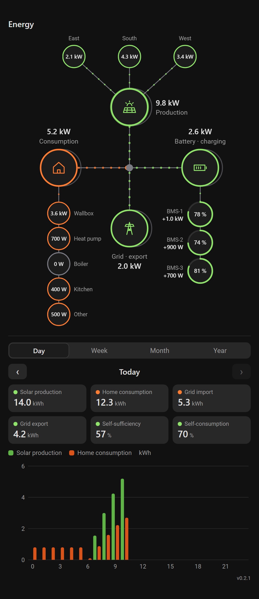
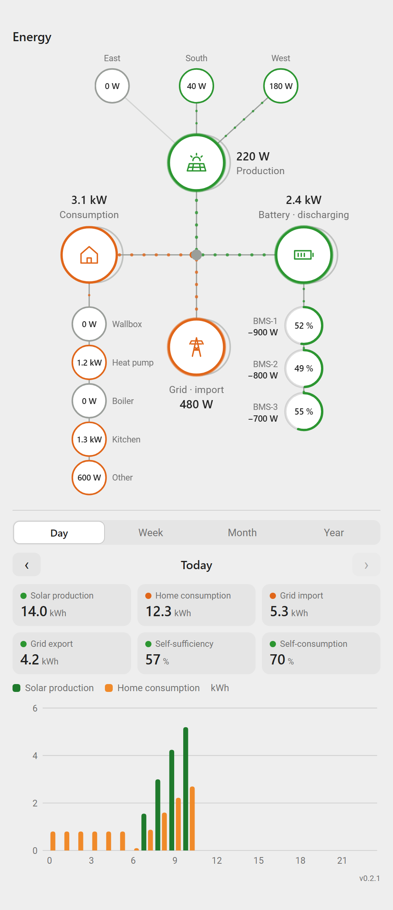

# UltimatePower Card

**English** · [Česky](README.cs.md)

A Home Assistant dashboard card that shows where your energy is flowing right now: solar production, house consumption, batteries and the grid, with animated flows and an energy balance you can page through. The layout follows the energy monitor known from Loxone.

<p>
  
  
</p>

The screenshots use demo data.

> **Status:** early development (v0.x). Options may change before the first stable release.

## Features

- **Four main nodes around a central hub:** production, consumption, battery and grid. The card fits one dashboard column.
- **Any number of PV strings, batteries and appliances.** Strings sit in a row above production; batteries (with a state-of-charge ring) and appliances hang below their node.
- **Colours with one meaning:** green is your own energy (production, battery, export), orange is consumption and grid import. Idle nodes turn grey.
- **Animated flow:** dots run from the source to the consumer and speed up steeply with power. A node that supplies energy pulses outwards, a node that draws energy pulses inwards.
- **No house sensor needed:** the house load is computed from PV, grid and battery. Whatever your listed appliances do not cover is shown as "Other".
- **Energy balance:** production, consumption, grid import and export, self-sufficiency and self-consumption per day, week, month or year. Page into the past with the arrows or by swiping the chart. The section can be switched off.
- **Batteries either way:** one signed power sensor, or separate charge and discharge sensors.
- Click a node to open its Home Assistant detail. English and Czech labels, light and dark theme.

Not yet available: visual config editor, custom colours and icons.

## Installation

### HACS

1. HACS → **⋮** → **Custom repositories**.
2. Add `Developer089/UltimatePower-Card`, type **Dashboard** (called *Lovelace* in older HACS).
3. Find **UltimatePower Card**, download it and reload the browser.

### Manual

1. Download `ultimate-power-card.js` from the [latest release](https://github.com/Developer089/UltimatePower-Card/releases).
2. Copy it to `/config/www/ultimate-power-card/`.
3. Add a dashboard resource: `/local/ultimate-power-card/ultimate-power-card.js`, type **JavaScript module**.

## Configuration

The card is configured in YAML. Only `grid_entity` is required.

```yaml
type: custom:ultimate-power-card
name: Energy
grid_entity: sensor.grid_power

pv_strings:
  - { power_entity: sensor.pv_east, name: East }
  - { power_entity: sensor.pv_west, name: West }

batteries:
  # one signed sensor: positive = discharging
  - power_entity: sensor.battery_1_power
    soc_entity: sensor.battery_1_soc
    name: Battery 1
  # or two sensors that are both always positive
  - charge_entity: sensor.battery_2_charge_power
    discharge_entity: sensor.battery_2_discharge_power
    soc_entity: sensor.battery_2_soc
    name: Battery 2

appliances:
  - { power_entity: sensor.wallbox_power, name: Wallbox }
  - { power_entity: sensor.heat_pump_power, name: Heat pump }
  - { power_entity: sensor.boiler_power, name: Boiler }
```

### Sign conventions

- **Grid:** positive = import, negative = export. Use `grid_invert: true` if your meter reports it the other way round, or `grid_export_entity` if import and export are two separate sensors.
- **Battery:** positive = discharging, negative = charging. Use `invert: true` on a battery whose sensor is the other way round.
- **House load** is not read from a sensor. It is `PV + grid + battery`, so it is only right when all three are configured.

Power sensors may be in W or kW.

### Options

| Option | Default | Meaning |
|---|---|---|
| `grid_entity` | required | Grid power. Positive = import, negative = export. |
| `grid_export_entity` | – | Only when import and export are two separate, always-positive sensors. |
| `grid_invert` | `false` | Set when the grid sensor reports export as positive. |
| `pv_strings[]` | – | `power_entity`, optional `name`. |
| `pv_total_entity` | sum of strings | Total PV power, if you have a dedicated sensor. |
| `batteries[]` | – | `soc_entity`, optional `name`, and the power either as one signed sensor `power_entity` (positive = discharging, `invert` flips it) or as two always-positive sensors `charge_entity` + `discharge_entity`. |
| `battery_total_entity`, `battery_invert` | sum of batteries | Total battery power and its sign switch. |
| `battery_charge_entity`, `battery_discharge_entity` | – | Total battery power as two always-positive sensors. |
| `appliances[]` | – | `power_entity`, `name`, optional `on_threshold_w`. |
| `show_other` | `true` | Show the computed remainder of the house load. |
| `update_interval` | `1` | How often the card redraws live values, in seconds (1–20). Sensors are not read more often than they report. |
| `animation` | `auto` | `auto` follows the system "reduce motion" setting, `always` ignores it, `off` never animates. |
| `animation_speed` | `1` | Multiplier for the flow speed. |
| `max_power` | `10000` | Power (W) at which the flow reaches full speed. |
| `show_w_not_kw` | `false` | Always show watts. |
| `show_statistics` | `true` | Show the energy balance section. |
| `statistics` | Energy dashboard | Override the energy sensors: `pv`, `grid_import`, `grid_export`, `battery_charge`, `battery_discharge` (one id or a list each). |
| `statistics.max_power_kw` | `100` | Highest power your installation can really reach, for example the main breaker of the house. A statistics row with more energy than that power could deliver in the time it covers is a counter glitch (the meter dropped to zero and came back) and is left out; the card says how many it skipped. |

### Energy balance

The balance reads Home Assistant long-term statistics, the same data the Energy dashboard uses. By default the card takes the solar, grid and battery sensors configured in the Energy dashboard, so set that up first. To use other sensors, list them under `statistics`; they must be energy sensors (kWh) with `state_class: total_increasing`.

## Development

```bash
npm install
npm run watch     # rebuilds on save into dist/
```

Copy `dist/ultimate-power-card.js` into `/config/www/` of a development Home Assistant.

## License

Apache License 2.0 — see [LICENSE](LICENSE).
