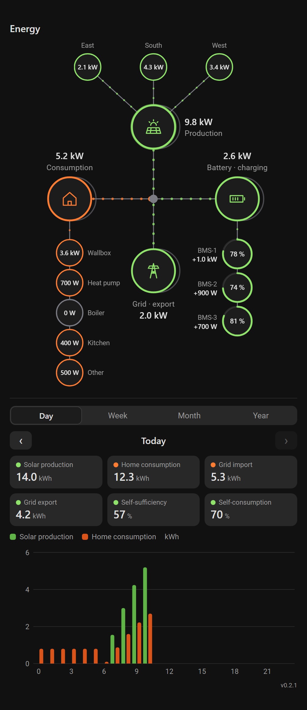

# UltimatePower Card

Energy flow card for Home Assistant: solar production, house consumption, batteries and the grid around a central hub, with animated flows and an energy balance per day, week, month or year.

Karta toku energie pro Home Assistant: výroba z fotovoltaiky, spotřeba domu, baterie a síť kolem společného středu, s animací toků a bilancí energie za den, týden, měsíc nebo rok.

- Any number of PV strings, batteries and appliances · libovolný počet stringů, baterií a spotřebičů
- House load computed from PV, grid and battery · spotřeba domu počítaná z FVE, sítě a baterie
- Energy balance with paging into the past · bilance energie s listováním do minulosti

[Documentation (English)](https://github.com/Developer089/UltimatePower-Card#readme) · [Dokumentace (česky)](https://github.com/Developer089/UltimatePower-Card/blob/main/README.cs.md)
